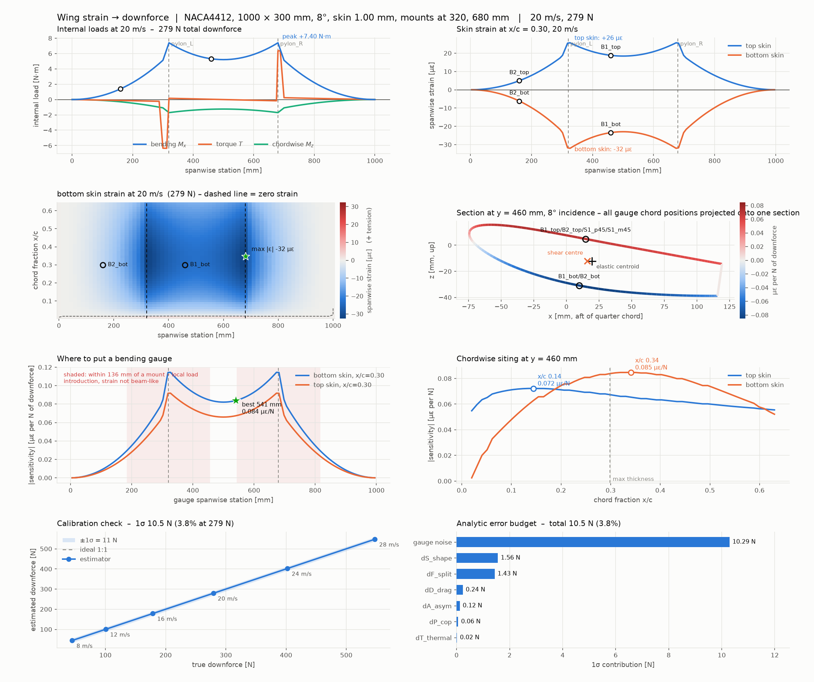

# wingstrain — wing strain → downforce

Work out what a strain gauge bonded to a composite wing will actually read, what
that reading is worth as a downforce measurement, and where to put the gauge to
make it worth more.

Built for a Formula Student team instrumenting a carbon rear wing. You vary the
wing (planform, aerofoil, incidence, layup, structural box, mount positions) and
the instrumentation (gauge station, chord position, surface, grid angle, bridge
type), and it gives you the strain in µε and mV/V, the calibration that turns
readings back into newtons, and an honest error budget for that number.

It is a structural model, not a CFD code: you supply the aerodynamic
coefficients from your own CFD, wind tunnel or track data, and it does the load
path, the composite section, the beam, the gauges and the inverse problem.



## Install

```bash
git clone https://github.com/TTNguyen32/wingstrain.git
cd wingstrain
pip install -r requirements.txt      # numpy, matplotlib
python tests/test_validation.py      # 23 checks against closed-form results
```

## Quickstart

```bash
python -m wingstrain --speed 20 --recommend --plots out/   # the baseline wing
python -m wingstrain --profile my_section.dat --speed 20   # your own aerofoil
python -m wingstrain --dump-config my_wing.json            # start your own
python -m wingstrain --config my_wing.json --pylons --mc 300 --plots out/
```

```python
from wingstrain import Airfoil, Laminate, Support, Gauge
from wingstrain.presets import baseline
from wingstrain.inverse import build_calibration

wing = baseline()
wing.spec.chord = 0.25
wing.spec.angle_deg = 12.0
wing.spec.airfoil = Airfoil.from_file("s1223.dat")
wing.spec.skin = Laminate.build([45, 0, -45], "twill_200")
wing.spec.supports = [Support(0.20, label="pylon_L"), Support(0.80, label="pylon_R")]
wing.spec.gauges = [Gauge("B1", y=0.50, xc=0.34, surface="bottom", bridge="half")]

print(wing.solve(20.0).report())
print(build_calibration(wing).describe())
```

### The interactive version

`artifact/` holds the same forward model ported to JavaScript — it agrees with
the Python to three significant figures — with sliders for the wing, the mounts
and the gauge, and drag-and-drop loading of your own aerofoil. It uses ES
modules, so serve it rather than opening the file directly:

```bash
python3 -m http.server 8000 --directory artifact
```

then open <http://localhost:8000/wing-strain-explorer.html>. Good for a design
meeting; use the Python for the multi-gauge estimator, taper, three-mount
layouts and the Monte Carlo.

## What it models

**Aerodynamic load.** Dynamic pressure × area × C_L, distributed along the span
by a chosen shape (uniform, elliptical, or a blend set by how well the endplate
keeps the tip loaded), acting at a chordwise centre of pressure. Upper flaps
that hang off the instrumented element are carried as discrete bracket loads at
their real spanwise stations — which matters more than almost anything else, as
below. Drag is carried too, since it bends the wing chordwise.

**Structure.** The wing is a beam in the spanwise direction. The section is a
single closed cell — the skin wrapping the nose plus a shear web — built from
wall segments, each with its own laminate. Classical laminate theory gives each
wall its membrane moduli, and the section model returns E-weighted `EI_xx`,
`EI_zz`, `EI_xz`, the Bredt–Batho `GJ`, and the shear centre from a full
shear-flow analysis. Unidirectional spar caps can be added as lumped areas.

Incidence is applied to the geometry before the section properties are taken, so
an inclined section is handled as the unsymmetric bending problem it really is
(`EI_xz` is *not* small for a wing at 8°, and vertical load produces chordwise
bending through it).

**Beam.** Finite element, with vertical bending, chordwise bending and St Venant
torsion, mounts anywhere, pinned or clamped. Internal loads come from statics
using the solved reactions, so `M(y)` is exact for the usual determinate
two-pylon layout no matter how coarse the mesh.

**Gauges.** At a gauge, the model resolves the strain state — spanwise from
bending, chordwise from Poisson, shear from torsion *and* from the transverse
shear flow — onto the grid direction, then applies grid-length averaging,
transverse sensitivity, misalignment, gauge factor, bridge factor and
excitation. `PylonGauge` does the same for a gauge on a mount strut.

**Inverse.** The forward model is linear in the load, so the strains are `A a`
for a basis of load cases. The basis is the *nominal* load case plus
zero-net-force perturbations — distribution shape, yaw asymmetry, flap/main load
split, drag, centre-of-pressure shift, thermal drift — each with a prior for how
far it can plausibly stray. A MAP (prior-regularised) inverse gives one row of
weights,

```
D [N] = Σ wᵢ · εᵢ [µε]
```

ready to program into the DAQ, plus an explicit budget: each unresolved load
case contributes `|w·A[:,k]| · priorₖ` newtons.

## Sign conventions

Car axes: `x` aft, `y` spanwise from the left tip, `z` up. Downforce is `−z`.
`M_x > 0` means tension on the **top** skin. Gauge surfaces are named as they sit
on the car — for an inverted wing `bottom` is the suction side. Grid angle is
measured from spanwise, so 0° is maximum bending sensitivity and ±45° picks up
torsion.

## What the baseline tells you

The preset is a plausible FS three-element rear wing: 1000 × 300 mm main plane,
NACA 4412 at 8°, 1 mm twill skin with a web at 65% chord, pylons 360 mm apart,
two flaps feeding load in through brackets. At 20 m/s it makes 279 N.

1. **The signal is small.** Peak skin strain is ~33 µε and the gauges see
   20–26 µε. A carbon wing built to a manufacturable minimum layup is stiff, and
   its reserve factor is in the hundreds — it is nowhere near structurally
   limited, so the measurement, not the wing, sets the layup choice. Halving the
   skin to two plies multiplies strain per newton by six.

2. **Mount spacing dominates.** Pylons at 0.207 × span make the overhang and
   mid-span moments cancel — elegant structurally, and the worst possible
   arrangement for measurement (0.07 µε/N against 0.37 µε/N at wider spacing).
   Check where your mounts actually are before choosing gauge stations.

3. **The best chord position is not max thickness.** Because the section sits at
   incidence, the material furthest from the neutral axis is aft of the thickest
   point — x/c ≈ 0.34 on the bottom skin here, not 0.30.

4. **Skin gauges measure the element they are on, not the wing.** The flaps'
   load enters through brackets sitting next to the pylons, so it produces
   almost no bending moment in the main plane. Main-plane strain is therefore
   blind to over half the wing's downforce, and converting to a total relies on
   a load split you have to take from CFD. That single assumption is the largest
   term in the budget.

5. **Gauge the struts as well.** The mounts carry 100% of the load, so a strut
   pair reads total downforce with the distribution, split and CoP terms
   *exactly* zero (verified in the test suite). Skin gauges plus strut gauges
   gets the baseline from ~14% to ~4%, and the skin channels still tell you
   where the load is acting.

6. **Thermal drift will beat you if you let it.** At 1.5 µε/K on a 20 µε signal,
   an uncompensated setup swamps the measurement — the largest term in the Monte
   Carlo by a factor of five. Carrying temperature as an extra unknown across
   several gauges removes it almost for free (0.006 N/K, no measurable noise
   cost). Two identical strut gauges *cannot* do this — their thermal and load
   directions are collinear — which is why a strut is instrumented as a Poisson
   full bridge. The model warns you when a channel set has this problem.

7. **Do a static hang test, but know what it fixes.** It removes the scale
   errors — laminate thickness and modulus scatter, bonding position, gauge
   factor, amplifier gain — roughly a third of the budget. It does **not** fix
   the load-shape terms, because hanging weights on the main plane does not
   reproduce how the flaps feed load in. Use it to correct the model gain, not
   as a downforce calibration in its own right.

## Your own aerofoil

```bash
python -m wingstrain --profile examples/profiles/sample_selig.dat --recommend
```

```python
Airfoil.from_file("e423.dat")          # a coordinate file
Airfoil.from_text(pasted_text)         # text you already have
Airfoil.from_points([[x, z], ...])     # an array from anywhere
```

Both orderings are read: **Selig** (one loop from the trailing edge, forward to
the nose, back to the trailing edge) and **Lednicer** (two runs from the nose
aft, with or without the point-count header). Coordinates can be in millimetres
or normalised, comma or space separated, with or without a name line, and the
leading edge need not sit at the origin — the contour is scaled to unit chord
about its own nose, so a profile exported from the middle of a CAD sketch does
not pick up phantom camber. Which run is the upper surface is decided by where
the material is, not by the file order. Nonsense input is rejected with a reason
rather than quietly producing a plausible wrong wing. `examples/profiles/` has
one sample in each convention.

A custom profile serialises with the configuration, so `--dump-config` on a wing
using one writes its points into the JSON and reloads identically.

## Examples

| script | what it does |
|---|---|
| `examples/01_baseline_report.py` | solve, report, write the dashboard figure |
| `examples/02_gauge_placement.py` | scan gauge positions, compare instrumentation plans |
| `examples/03_design_sweeps.py` | sweep layup, mounts, incidence, chord, span, web, aerofoil |
| `examples/04_error_budget.py` | Monte Carlo budget and the static hang test |

## Verification

`tests/test_validation.py` — 23 checks against closed-form results: UD and
quasi-isotropic laminate moduli; thin-walled box `I` and Bredt–Batho `J`;
shear-centre symmetry; cantilever tip load and UDL; simply supported UDL;
overhanging beam moments; the two-span indeterminate case; torsion cantilever;
Mohr strain transformation; bridge output; `V²` scaling; global equilibrium;
coordinate-file parsing across four conventions; and that the estimator is exact
for the load case it was built on.

## Limitations worth knowing

* Euler–Bernoulli beam with St Venant torsion: no shear lag, no restrained
  warping, no bend–twist coupling from an unbalanced layup, no local load
  introduction at the mounts — which is why the siting tool keeps gauges 2.5
  section depths clear of a mount.
* Single closed cell for torsion. Extra webs contribute to `EI` only.
* Aerodynamic coefficients are yours to supply; the spanwise shape is
  parametric, not a lifting-line or panel solution. A loaded profile changes the
  structure — section depth, `EI`, `GJ`, shear centre — but not `C_L`; set that
  from your own data.
* Chordwise surface strain is taken as `−ν·ε_span`, the usual beam-surface
  approximation; hoop constraint in a real shell makes it slightly smaller.
* Mounts are rigid. Pylon and endplate compliance would add deflection and, for
  a statically indeterminate mount layout, change the load split.
* Linear elastic and small deflection throughout — appropriate here, since the
  baseline wing deflects a fraction of a millimetre.

## Repository layout

| file | what it holds |
|---|---|
| `wingstrain/laminate.py` | ply materials, classical laminate theory |
| `wingstrain/airfoil.py` | NACA 4-digit, coordinate files, axes transforms |
| `wingstrain/section.py` | thin-walled section, `EI`, `GJ`, shear centre, shear flow |
| `wingstrain/beam.py` | FE beam: bending, chordwise bending, torsion, mounts |
| `wingstrain/aero.py` | dynamic pressure, spanwise shapes, carried elements |
| `wingstrain/gauges.py` | gauge and strut-gauge models, bridges, rosettes |
| `wingstrain/model.py` | assembly: `WingSpec` → `Wing.solve(V)` → `Result` |
| `wingstrain/inverse.py` | load-case basis, MAP estimator, siting tools |
| `wingstrain/uncertainty.py` | Monte Carlo budget, static hang test |
| `wingstrain/plots.py` | figures and the one-page dashboard |
| `wingstrain/config.py`, `cli.py` | JSON configuration and command line |
| `artifact/physics.js` | JS port of the forward model |
| `artifact/wing-strain-explorer.html` | the interactive bench |

## Licence

MIT — see [LICENSE](LICENSE).
